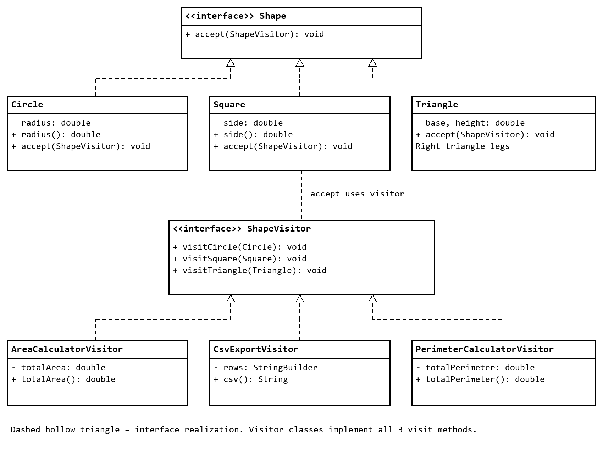

# Shape Visitor Pattern

Assignment 6  |  ShP 2216 Software Design Patterns
Astana IT University  |  School of Computer Engineering

Student: Asankhan Shyngys
Group: SE-2504

## Introduction

This project implements the official Shape Visitor topic. A Drawing contains Circle, Square and Triangle elements. AreaCalculatorVisitor calculates area, CsvExportVisitor serializes shape dimensions, and PerimeterCalculatorVisitor demonstrates an additional operation without changing existing elements.

Each shape implements accept and invokes the corresponding visitor method. Drawing owns traversal; visitors own algorithms and result state. This separation keeps the geometry elements stable when new operations are introduced.

## Geometry model and responsibilities

Circle stores a radius, Square stores a side length, and Triangle stores perpendicular base and height legs. Triangle explicitly represents a right triangle: base and height alone would not determine a general triangle’s perimeter. Dimensions must be positive and finite and use a consistent arbitrary unit.

```
Drawing
  Circle(radius = 2)
  Square(side = 3)
  Triangle(base = 3, height = 4)  // Right triangle
```

The element records are immutable. Drawing takes a defensive copy of its list and invokes accept on each shape in insertion order. Each operation receives the same drawing through a fresh visitor. CSV dimension1 means radius, side or base; dimension2 contains triangle height and is empty for the other types.

## UML class diagram



The diagram shows the required element interface, three concrete elements, visitor interface and three concrete visitors. Drawing aggregates zero or more Shape objects and traverses them; the editable PlantUML source also shows Drawing and its dependencies.

## Double dispatch

```
for (Shape shape : shapes) shape.accept(visitor);
// Circle.accept: this has compile-time type Circle
visitor.visitCircle(this);
```

The first dispatch selects accept using the runtime shape type. Circle.accept then calls visitCircle, whose implementation is selected using the runtime visitor type. A Circle with AreaCalculatorVisitor adds πr²; the same Circle with CsvExportVisitor writes its dimensions. Square and Triangle select their own matching methods. No type-inspection chain chooses an operation.

## Clean Code and emergent design

The following annotated excerpts apply Chapter 12 guidance: run all tests, remove duplication, express intent and keep classes and methods minimal. Each excerpt is tied to a concrete design decision.

### 1 Run all the tests

```
close(area(new Drawing(List.of(new Circle(2)))), 4 * Math.PI);
close(area(new Drawing(List.of(new Triangle(3, 4)))), 6);
```

The suite checks independent formula expectations, collection behavior and invalid inputs. Explicit assertions fail without requiring JVM assertion flags. The tests also cover overflow, locale-independent CSV output, immutable snapshots and independent concurrent calculations.

### 2 Remove duplication

```
static void requirePositive(double value) {
    if (!Double.isFinite(value) || value <= 0)
        throw new IllegalArgumentException(
            "Dimensions must be positive and finite");
}
```

The package-private Dimensions helper centralizes the same validation rule for all shape constructors. Drawing centralizes traversal, so area, CSV and perimeter visitors do not duplicate iteration. The helper has no public API and no mutable state.

### 3 Express intent with names

```
var area = new AreaCalculatorVisitor();
var export = new CsvExportVisitor();
drawing.acceptAll(area); drawing.acceptAll(export);
```

Class names distinguish element data from visitor operations. totalArea and totalPerimeter identify results, and radius, side, base and height express the geometric inputs. The right-triangle assumption is explicit in the element documentation.

### 4 Keep the design minimal

```
@Override public void accept(ShapeVisitor visitor) {
    visitor.visitSquare(this);
}
```

Each accept method only performs dispatch. Three elements and three visitors cover the assignment roles, while Drawing owns the collection. There is no unnecessary abstract factory, visitor inheritance hierarchy or concurrency service in the domain model.

## Clean Code and concurrency defenses

### 5 Give each visitor one responsibility

```
@Override public void visitSquare(Square s) {
    add(s.side() * s.side());
}
```

AreaCalculatorVisitor only calculates area; CsvExportVisitor only serializes dimensions; PerimeterCalculatorVisitor only calculates perimeter. Demo owns presentation and Drawing owns traversal. Visitors implement every visit method with operation-specific logic.

### 6 Limit mutable data and use copies

```
public Drawing { shapes = List.copyOf(shapes); }
public String csv() { return rows.toString(); }
```

Chapter 13 recommends limiting mutable data scope and using copies. Drawing protects its input list, shape records expose read-only dimensions, and the CSV visitor returns an immutable String snapshot. Visitors need dimension access but never receive a mutable shape or drawing collection.

### 7 Keep tasks independent

```
tasks.add(() -> area(drawing));
// area creates a fresh AreaCalculatorVisitor for each task
for (var result : pool.invokeAll(tasks))
    close(result.get(), 4 * Math.PI + 15);
```

The concurrency test runs 100 tasks against a shared immutable drawing with a separate visitor per task. A fixed ExecutorService manages execution, Future.get observes completion and failures, and finally shuts down the executor. Mutable visitors are task-confined. Production traversal is sequential, keeping concurrency concerns separate from geometry logic.

### 8 Add operations without changing elements

```
public final class PerimeterCalculatorVisitor implements ShapeVisitor {
    @Override public void visitSquare(Square s) { add(4 * s.side()); }
    // Other visit methods, state and result accessor omitted here.
}
```

The perimeter visitor was added in its own commit with no edits to Circle, Square or Triangle. Existing double-dispatch methods select the new algorithm through the same interface. Adding a new shape type would still require extending ShapeVisitor and every concrete visitor, which is the main Visitor tradeoff.

## Sample execution and verification

The three visitors run on exactly the same Drawing instance from Demo.sampleDrawing. Each visitor is newly created before traversal.

```
PS> ./run.ps1
Drawing: Circle(radius=2), Square(side=3),
         Triangle(base=3, height=4)
Total area: 27.566371 square units
CSV export:
type,dimension1,dimension2
Circle,2.000000,
Square,3.000000,
Triangle,3.000000,4.000000
Total perimeter: 36.566371 units
```

The exact area is 4π + 9 + (3 × 4 / 2) = 4π + 15, displayed as 27.566371 square units. The perimeter is 4π + 12 + (3 + 4 + 5) = 4π + 24, displayed as 36.566371 units. CSV preserves shape order and formats dimensions to six decimal places using Locale.ROOT.

```
PS> ./run.ps1 -Test
PASS: 141 checks
```

## Verification scope

Compilation passed with javac --release 17 -Xlint:all -Werror. Execution used JDK 25.0.1; a JDK 17 runtime was not available for direct execution. The release flag enforces Java 17 syntax and platform APIs and produces compatible class files.

Checks cover individual and total areas, total perimeter and dispatch across all shapes, exact CSV output, empty drawings, repeated visitor accumulation, defensive input copies, export snapshots, invalid dimensions, null arguments, overflow, locale changes and 100 independently executed calculations.

Run ./run.ps1 for the demo and ./run.ps1 -Test for checks. In IntelliJ IDEA use JDK 17 or newer, mark src/main/java as Sources Root and src/test/java as Test Sources Root, and run shapes.Demo or shapes.ShapeTests.

## Conclusion and encapsulation tradeoffs

Visitor supports area calculation, CSV serialization and perimeter calculation over one stable shape structure. A new operation was added as a concrete visitor without modifying element implementations. Double dispatch selects the matching method, and Drawing supplies one consistent traversal.

Visitors require access to dimensions. Immutable record accessors expose that metadata without allowing mutation. Drawing copies its collection and exposes an unmodifiable list; export returns an immutable snapshot. This preserves storage boundaries while accepting that richer operations might require additional public metadata.

New shape types are the main cost: a new element requires a visitor-interface method and implementations in every visitor. Stateful visitors accumulate if reused, so the demo uses fresh instances. Visitors must remain confined to one task; immutable drawings and shapes can be shared across tasks.

Numeric results use double precision. Extremely small values may underflow, and non-finite computed totals throw ArithmeticException. CSV rounds dimensions to six decimal places and is not a lossless round-trip format. These limits are documented rather than hidden behind additional abstractions.

## Repository

GitHub repository URL: __________________________________________

The local repository contains separate commits for the model, first two visitors, perimeter extension, executable checks and documentation. The README explains how to publish the complete history to an empty GitHub repository and insert its real URL before Moodle submission.

## Defense preparation

Demonstrate the accept/visit trace, run both the demo and checks, explain why Triangle is a right triangle, and show the perimeter extension commit. The defense guide includes practice questions about double dispatch, operation extensibility, encapsulation and task confinement.

## References

Assignment 6 Visitor Pattern Instructions, ShP 2216, Astana IT University: official Option B and deliverable requirements.
Robert C. Martin, Clean Code, Chapters 12 and 13: emergent design and concurrency principles specified by the assignment page.
Project evidence: src/main/java/shapes, src/test/java/shapes/ShapeTests.java, docs/uml.puml and docs/sample-output.txt.
